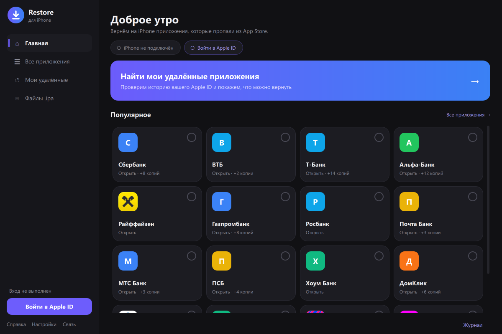
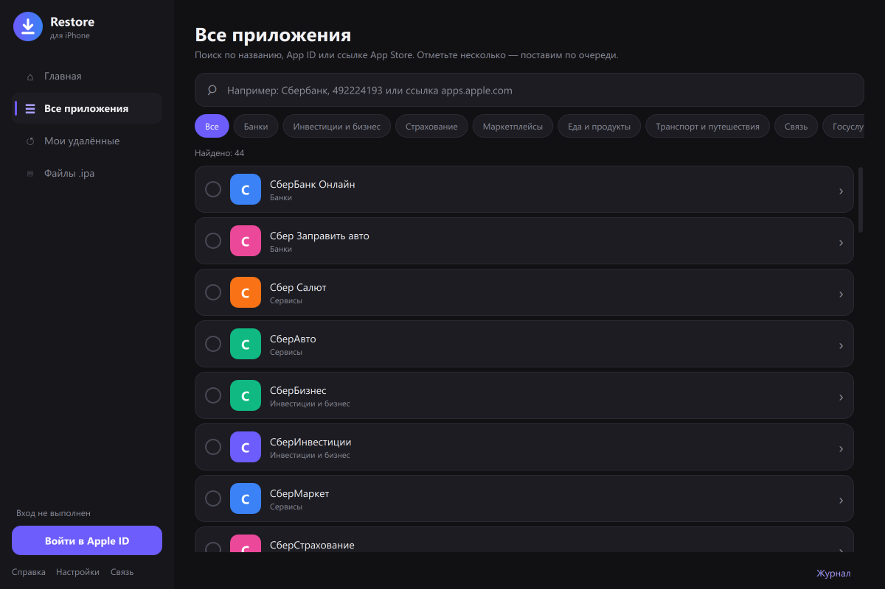
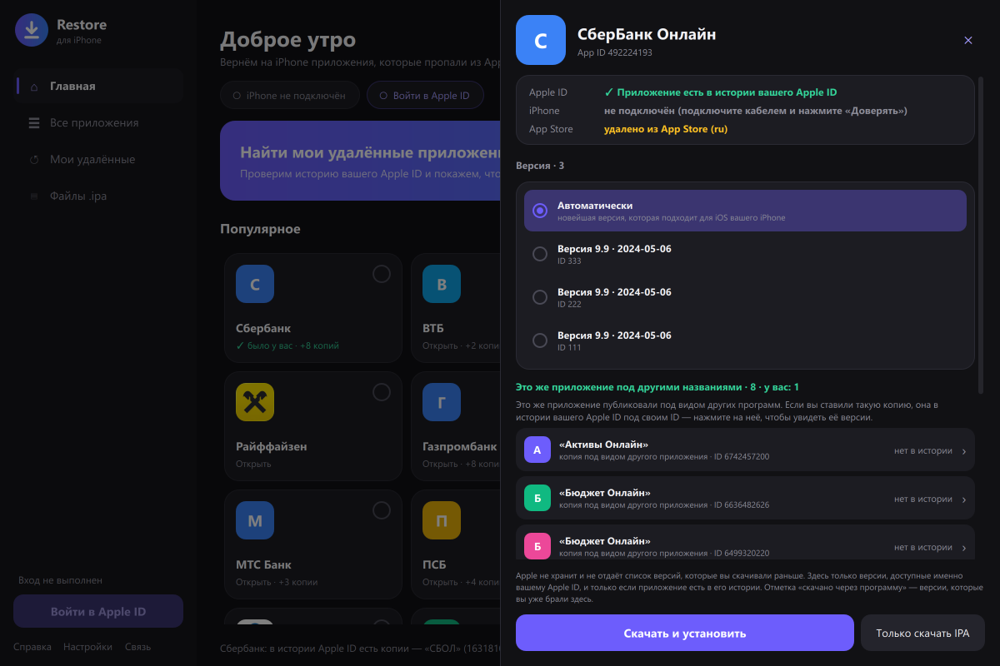

<p align="center">
  
</p>

<h1 align="center">Restore</h1>

<p align="center">
  Возврат на iPhone приложений, которые удалили из российского App Store:<br>
  банки, Госуслуги, маркетплейсы и сотни других. Для Windows.
</p>

<p align="center">
  <a href="../../releases/latest"><b>Скачать</b></a> ·
  <a href="#как-пользоваться">Как пользоваться</a> ·
  <a href="#частые-проблемы">Частые проблемы</a> ·
  <a href="#безопасность-и-данные">Безопасность</a> ·
  <a href="CHANGELOG.md">Изменения</a>
</p>

<p align="center">
  <a href="../../actions/workflows/tests.yml"></a>
  <a href="../../actions/workflows/release.yml"></a>
</p>



> [!IMPORTANT]
> Restore скачивает приложения с серверов Apple **под вашим Apple ID** и только те, что **уже есть в истории покупок этого аккаунта** — то есть когда-то были у вас установлены. Чужое или никогда не скачанное приложение Apple не отдаст, и программа не пытается это обойти.

## Возможности

- **Каталог из 700+ удалённых приложений** с поиском по названию, App ID или ссылке App Store, делением на категории и настоящими иконками из App Store (у приложений, которые Apple удалил отовсюду, вместо иконки — буква).
- **Поиск своих приложений:** программа проверяет историю вашего Apple ID и показывает, какие из удалённых приложений у вас были.
- **Копии под другими названиями.** Банки часто публиковали приложение под видом другого (например, «СберБанк Онлайн» как «СБОЛ» или «Умный Онлайн»). В окне приложения видны все его копии, и программа сама проверяет, какие из них есть у вас.
- **Выбор версии.** Список версий, доступных вашему Apple ID, с номерами и датами. Режим «Автоматически» сам подберёт новейшую версию, которая подходит для iOS вашего iPhone.
- **Установка по кабелю** прямо из программы, в том числе нескольких приложений по очереди. Готовый `.ipa` можно поставить и без Apple ID.
- **Понятные ошибки.** Вместо кодов ipatool — объяснение по-русски: DNS «для обхода блокировок», антивирус с проверкой HTTPS, ограничение попыток входа и т. п.

<table>
  <tr>
    <td width="58%"></td>
    <td width="42%"></td>
  </tr>
  <tr>
    <td align="center">Каталог и поиск</td>
    <td align="center">Панель приложения: версии и копии (демо-данные)</td>
  </tr>
</table>

## Что нужно

- Windows 10 или 11 (64-бит).
- **iTunes** или **«Устройства Apple»** (Apple Devices) из Microsoft Store — это драйвер, без него Windows не видит iPhone.
- iPhone и кабель. Телефон разблокирован, на запрос «Доверять этому компьютеру?» нажмите «Доверять».
- Apple ID, под которым приложение когда-то скачивалось.

## Запуск

Устанавливать ничего не нужно: программа — один файл.

1. Скачайте `RestoreAppStore.exe` со страницы [Releases](../../releases/latest) и положите в любую папку.
2. Запустите. Права администратора не нужны.

При каждом запуске exe распаковывается во временную папку `%TEMP%\_MEI…` (поэтому открывается 2–3 с) и при выходе удаляет её. Папку, оставшуюся после аварийного завершения, программа удалит сама при одном из следующих запусков.

Чтобы удалить программу полностью, удалите `RestoreAppStore.exe`, папку `ipa` рядом с ним (скачанные `.ipa`) и папку `%LOCALAPPDATA%\Restore`. Больше программа ничего не создаёт — подробнее в разделе [«Безопасность и данные»](#безопасность-и-данные).

> [!NOTE]
> Программа не подписана сертификатом, поэтому Windows SmartScreen может показать предупреждение «Windows защитила ваш компьютер». Нажмите «Подробнее» → «Выполнить в любом случае». Контрольные суммы файлов — в `SHA256SUMS.txt` релиза.

## Как пользоваться

1. **Войдите в Apple ID** (кнопка слева внизу). Код подтверждения придёт на ваши устройства Apple. Самый первый вход на компьютере может занять до 10–15 минут: ipatool скачивает служебные файлы Apple для подписи запросов.
2. **Найдите приложение:** плитки на главной, поиск во «Все приложения» или кнопка **«Найти мои удалённые приложения»** — она проверит весь каталог по истории вашего аккаунта (несколько минут).
3. **Откройте приложение** — справа выедет его панель. Вверху — есть ли оно в истории вашего Apple ID, подключён ли iPhone и удалено ли из App Store. Если у приложения есть копии под другими названиями, они в отдельном блоке под версиями; нажмите на копию с отметкой «✓ есть у вас», чтобы открыть её версии.
4. **Выберите версию** (или оставьте «Автоматически») и нажмите **«Скачать и установить»**. «Только скачать IPA» сохранит файл, не трогая телефон.

Скачанные `.ipa` хранятся в папке `ipa` рядом с exe (если туда писать нельзя — в `Документы\Restore\ipa`) и повторно не скачиваются. Их можно поставить позже на вкладке «Файлы .ipa».

## Частые проблемы

| Что видите | Причина и решение |
|---|---|
| Нет связи с Apple, `no such host`, `i/o timeout` | DNS «для обхода блокировок» (Comss, GeoHide и т. п.) или записи в `hosts` подменяют адреса Apple. Верните автоматический DNS. Кнопка **«Связь»** внизу слева проверит все нужные адреса. |
| Ошибка сертификата, `x509` | Антивирус проверяет HTTPS (Касперский, ESET, Dr.Web). Отключите проверку защищённых соединений или добавьте программу в исключения. |
| «Не было у этого Apple ID» | Приложения нет в истории аккаунта. Проверьте копии под другими названиями или войдите под тем Apple ID, которым скачивали. |
| Apple ограничил попытки, `429` | Не повторяйте вход подряд — подождите около часа. |
| iPhone не найден | Нужен iTunes или «Устройства Apple», кабель, разблокированный телефон и «Доверять». |
| Версия не подходит для iOS | Выберите «Автоматически» — программа подберёт версию под ваш iPhone. |

Подробности любой ошибки — в **«Журнале»** (кнопка справа внизу). Если пишете об ошибке, приложите текст оттуда, предварительно убрав свой email.

## Безопасность и данные

- **Пароль Apple ID не сохраняется.** Он передаётся только ipatool для входа. Сессия входа хранится в зашифрованном файле, пароль к которому живёт лишь в памяти программы, и **удаляется при выходе из аккаунта, при закрытии программы и при следующем запуске**.
- **Email Apple ID на диск не записывается**: поле входа каждый раз пустое.
- **Всё служебное — в `%LOCALAPPDATA%\Restore`:** история скачанных через программу версий, кэш номеров версий и иконки приложений (публичные данные Apple), служебные файлы Apple для входа и эмулятор Unicorn (папка `ipatool`, около 60 МБ). Сессия входа лежит там же, только пока программа открыта. Кроме этой папки и `ipa` рядом с exe, программа ничего не оставляет: ни ярлыков, ни записей в реестре, ни временных файлов.
- Программа обращается только к серверам Apple (в том числе за иконками приложений) и к GitHub (последний — лишь если ipatool не нашёл встроенный эмулятор Unicorn).
- Ограничение ipatool: пароль передаётся ему аргументом командной строки, поэтому на время входа он виден другим программам под вашей учётной записью.
- **Скачанные `.ipa` содержат ваш Apple ID и имя** (`iTunesMetadata.plist`) и привязаны к вашему аккаунту. Не выкладывайте их в открытый доступ.

## Запуск из исходников

Нужен Python 3.15 и [ipatool](https://github.com/majd/ipatool/releases): для окна — в `PATH` или рядом со скриптами, для консольной версии — в `PATH`. Пакеты ставятся по тому же полному списку, что у сборки:

```bash
py -V:3.15 -m pip install --no-deps --only-binary=:all: -r requirements-build.txt
```

```bash
py -V:3.15 restore_apps_gui.py
```

Есть и консольная версия:

```bash
python restore_apps.py search сбер
```

```bash
python restore_apps.py restore 492224193
```

У консольной версии каждая команда — отдельный процесс, поэтому сессия входа и пароль к её зашифрованному файлу (`%LOCALAPPDATA%\Restore\keychain.pass`) хранятся между командами. Закончив, выйдите — это удалит и то и другое:

```bash
python restore_apps.py logout
```

Тесты (без сети, Apple ID и iPhone; настоящие данные программы в `%LOCALAPPDATA%\Restore` не трогают):

```bash
py -V:3.15 -m unittest discover -s tests
```

На GitHub те же тесты идут на Windows при каждом пуше и в пулл-реквестах — workflow «Тесты» (`.github/workflows/tests.yml`).

## Устройство кода

| Файл | Что внутри |
|---|---|
| `restore_apps.py` | ядро и консольная версия: каталог, пути, запуск ipatool |
| `restore_apps_gui.py` | запуск оконной версии |
| `restore_gui/qml/` | интерфейс на Qt Quick: главное окно, страницы, панель приложения, диалоги |
| `restore_gui/backend.py` | всё, что видит окно: состояние, списки, действия кнопок |
| `restore_gui/detail.py` | панель приложения: история Apple ID, копии под другими названиями, версии |
| `restore_gui/tasks.py` | долгие операции в фоне: вход, поиск по каталогу, скачивание, установка |
| `restore_gui/app.py`, `models.py`, `icons.py` | запуск окна; списки для QML; иконки из App Store |
| `restore_gui/catalog.py` | категории, семьи копий, поиск — без интерфейса |
| `restore_gui/apple.py` | ipatool и сервера Apple: разбор ответов, объяснения ошибок |
| `restore_gui/device.py`, `storage.py`, `theme.py` | iPhone и .ipa; служебные файлы; палитра |
| `tests/` | тесты: логика, окно, нажатия мышью |
| `build.ps1`, `RestoreAppStore.spec`, `requirements-build.*` | сборка exe (PyInstaller) и пакеты для неё |
| `tools/release.py`, `CHANGELOG.md`, `.github/workflows/` | версия, описание выпусков, тесты и выпуск на GitHub |

## Сборка

```bash
powershell -ExecutionPolicy Bypass -File build.ps1
```

Заранее ничего ставить не нужно: скрипт сам скачивает в `build\` Python 3.15 (официальный пакет python.org с nuget.org), ipatool 2.7.0 и Unicorn 2.1.4 из официальных релизов, сверяя **SHA-256** каждого файла. Затем создаёт окружение `build\venv` по `requirements-build.txt`, прогоняет тесты и собирает PyInstaller'ом `dist\RestoreAppStore.exe` и `dist\SHA256SUMS.txt`. Кэши pip и PyInstaller тоже остаются в `build\`.

Из Qt в сборку попадает только то, что нужно интерфейсу (список исключений — `DROP` в `RestoreAppStore.spec`). После сборки exe запускается с ключом `--check-ui`: интерфейс загружается без показа окна, и если из Qt вырезано что-то нужное, сборка останавливается.

Пакеты: верхний уровень — в `requirements-build.in`, полный список с точными версиями — в `requirements-build.txt`. Он составлен [uv](https://docs.astral.sh/uv/); команда, чтобы составить его заново, — в шапке `requirements-build.in`.

## Выпуск версии

Версии — по [SemVer](https://semver.org/lang/ru/): `X.Y.Z`. Номер один на весь проект — `__version__` в `restore_apps.py`, его же показывают окно программы и свойства exe.

1. Поднимите `__version__` в `restore_apps.py` и добавьте в [CHANGELOG.md](CHANGELOG.md) раздел `## X.Y.Z — дата` с описанием изменений.
2. Закоммитьте, поставьте тег и отправьте его:

   ```bash
   git tag vX.Y.Z
   ```

   ```bash
   git push origin main vX.Y.Z
   ```

3. Workflow «Выпуск» (`.github/workflows/release.yml`) проверит, что тег совпадает с `__version__` и в `CHANGELOG.md` есть раздел этой версии, прогонит тесты, соберёт `RestoreAppStore.exe` и `SHA256SUMS.txt` через `build.ps1` и опубликует релиз с описанием из `CHANGELOG.md`. Если что-то не сходится или тесты падают, релиза не будет.

Пробная сборка без релиза: Actions → «Выпуск» → Run workflow. Файлы появятся артефактом прогона.

## Лицензия

[GPL-3.0](LICENSE). Программа включает компоненты под GPL (pymobiledevice3, Unicorn), LGPL-3.0 (Qt / PySide6), MIT (ipatool) и другие — см. [THIRD_PARTY_NOTICES.md](THIRD_PARTY_NOTICES.md).

Проект не связан с Apple. App Store, iPhone и iOS — товарные знаки Apple Inc. Используйте программу только для приложений из истории покупок своего Apple ID.
